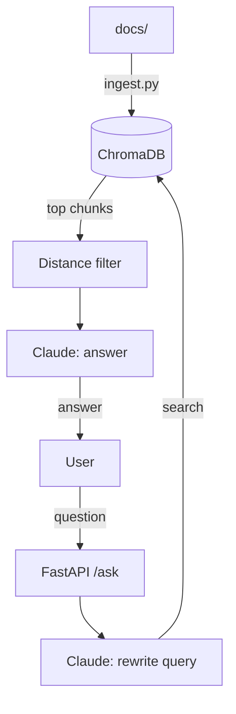

# RAG Chatbot

An AI chatbot that answers questions from your own documents, using retrieval-augmented generation (RAG), ChromaDB, and Claude.

**Live demo:** http://34.213.166.252/docs

## Features

- **Document Q&A**: answers only from ingested files (PDF, TXT, MD), never from general knowledge
- **Query rewriting**: Claude turns vague follow-ups ("what about chapter 2?") into standalone search queries and picks the most relevant file
- **Chat sessions**: remembers conversation history per session
- **Relevance filtering**: drops weak matches by vector distance
- **Rate limiting**: 10 requests/hour and 30/day per IP (slowapi)
- **Incremental ingest**: re-ingests changed files and removes deleted ones
- **Dockerized** and **deployed on AWS EC2**

## Architecture



## Tech Stack

Python · FastAPI · ChromaDB · Claude API (Haiku) · Docker · AWS EC2 · Ubuntu

## Project Structure

```
config.py    # settings (chunk size, model, limits)
db.py        # ChromaDB client and collection
loader.py    # read PDF/TXT/MD, split into chunks
ingest.py    # load docs into the vector DB
llm.py       # Claude calls: query rewrite and answer
models.py    # request schema
app.py       # FastAPI app and /ask endpoint
Dockerfile
```

## Run Locally

```bash
pip install -r requirements.txt
echo "ANTHROPIC_API_KEY=your_key" > .env
mkdir docs   # add .pdf / .txt / .md files
python ingest.py
uvicorn app:app --reload
```

Open http://127.0.0.1:8000/docs

## Run with Docker

```bash
docker build -t rag-bot .
docker run -p 8000:8000 --env-file .env rag-bot
```

## Deployment

Runs on AWS EC2 (Ubuntu, t3.micro) in Docker, with an Elastic IP, swap for low-memory embedding, and a Dockerfile ordered so the ingest step stays cached.

## Sample Docs

The demo uses public-domain texts (_The Count of Monte Cristo_, the King James Bible, the Bhagavad Gita, the Koran) plus an `about-me.md`. Try "Who is Ranjeet?" or "What does Krishna say about duty?"

## Roadmap

- Chat web UI
- Automated evals
- HTTPS and a custom domain
